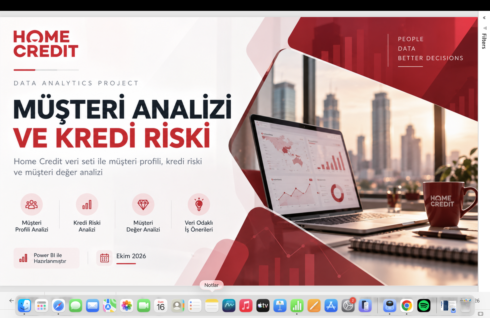
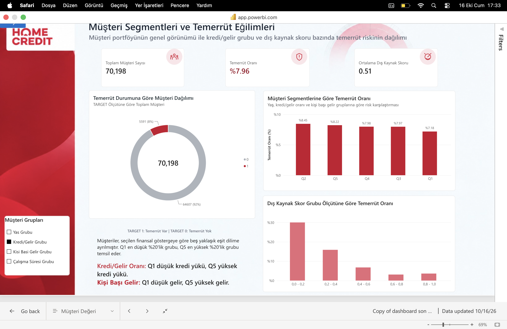
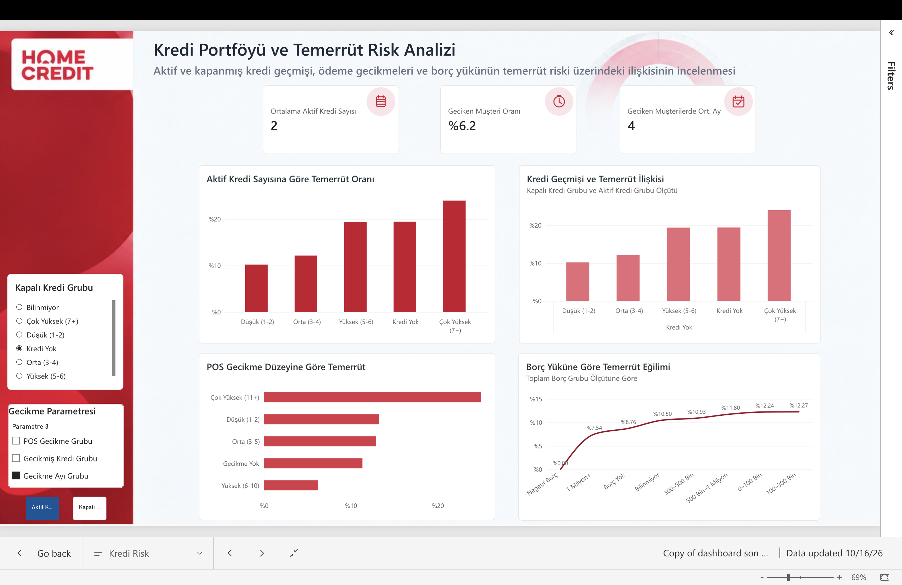
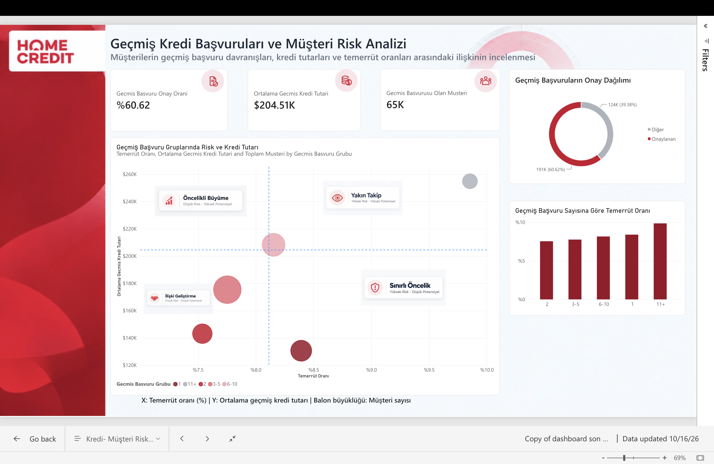
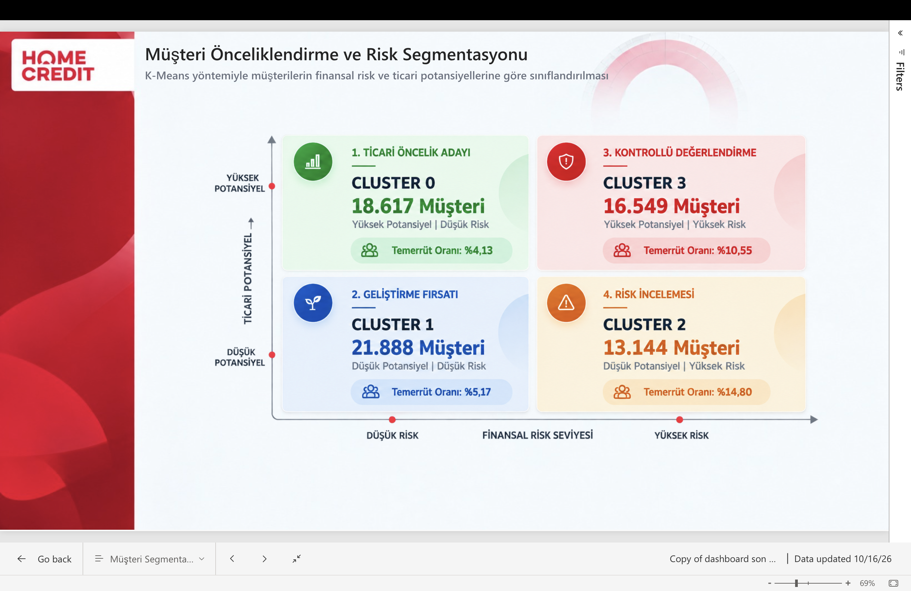
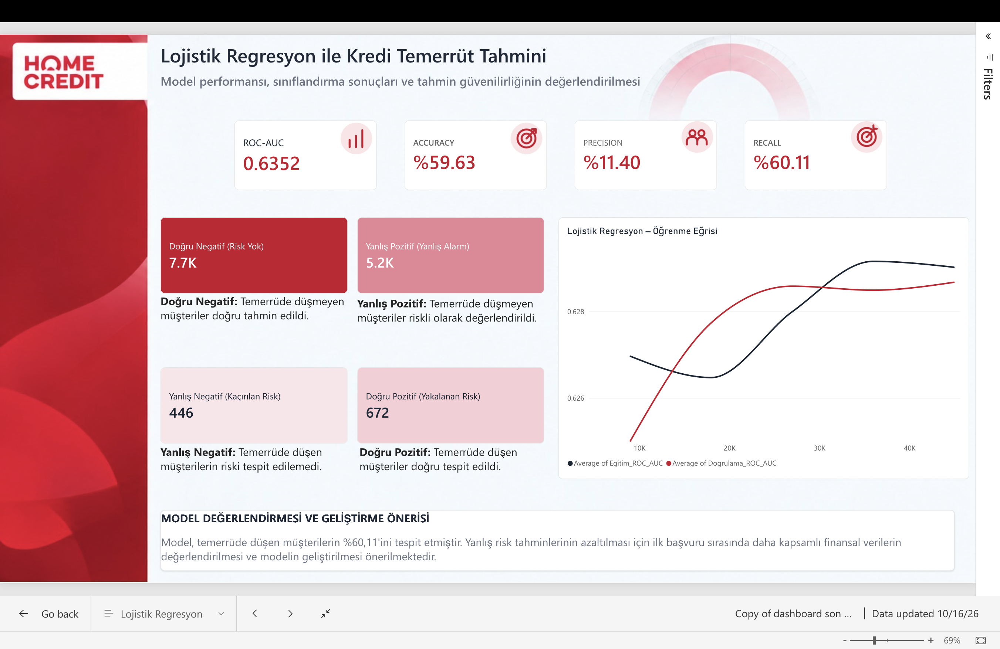
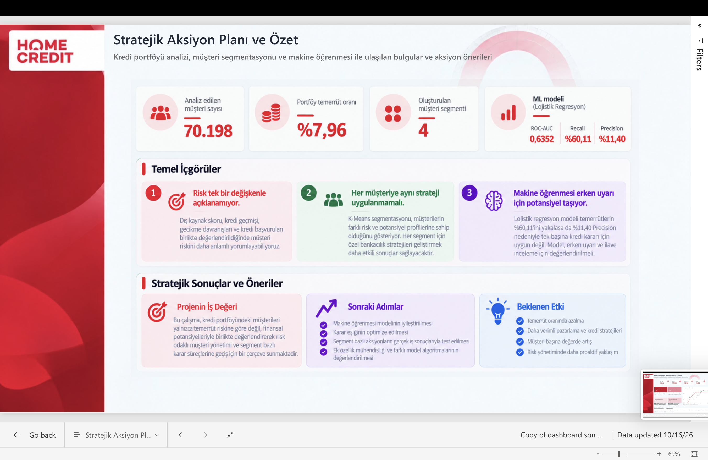

# Home Credit | Risk-Adjusted Customer Value Analysis

## Project Overview
This project analyzes the Home Credit dataset to explore the relationship between customer credit risk, repayment behavior, and customer value.

The goal is to transform complex financial data into actionable business insights that support data-driven decision-making in banking.

## Project Objectives
- Analyze customer default risk and repayment behavior.
- Identify key factors associated with credit risk.
- Develop customer segments based on risk and business potential.
- Build machine learning models to predict loan default.
- Translate analytical findings into practical banking strategies.

## Tools & Technologies
- **SQL & BigQuery:** Data exploration and analysis
- **dbt:** Data transformation and modeling
- **Python:** Data preparation, exploratory analysis, and machine learning
- **Power BI:** Interactive dashboards and reporting

## Business Impact
The project aims to support more effective customer portfolio management by identifying growth opportunities, improving risk monitoring, and developing differentiated customer strategies.

## Dataset
Home Credit Default Risk — Kaggle

## Project Status
Capstone project — Final analysis and documentation in progress.

## Power BI Dashboard Gallery

### 1. Project Overview

### 2. Customer Analysis

### 3. Credit Risk Analysis

### 4. Previous Loan Applications

### 5. K-Means Customer Segmentation

### 6. Machine Learning Results

### 7. Strategic Summary

## Business Insights & Strategic Banking Recommendations

### From Data Analysis to Banking Decisions

How can analytical findings be translated into real-world banking strategies?

Based on K-Means customer segmentation, four differentiated strategies were developed by considering customer credit risk and financial potential.

### Cluster 0 — Priority Growth
**Low Risk | High Potential | Default Rate: 4.13%**

This segment represents a key growth opportunity.

**Recommended actions:**
- Offer pre-approved financing solutions to eligible customers, subject to credit assessments.
- Evaluate appropriate credit limit increases and competitive pricing.
- Identify cross-selling opportunities across banking products.
- Strengthen customer loyalty through targeted campaigns.

**Business Objective:** Accelerate profitable portfolio growth while maintaining credit quality.

### Cluster 1 — Relationship Development
**Low Risk | Low Potential | Default Rate: 5.17%**

The priority for this segment is to strengthen existing customer relationships rather than aggressively expand lending.

**Recommended actions:**
- Encourage automatic bill payment instructions.
- Increase digital banking adoption.
- Offer personalized products based on customer needs.
- Improve customer engagement through cost-efficient channels.

**Business Objective:** Increase customer lifetime value and strengthen long-term relationships.

### Cluster 3 — Controlled Growth & Risk Monitoring
**High Risk | High Potential | Default Rate: 10.55%**

Despite elevated credit risk, this segment presents significant lending potential.

Rather than excluding these customers, the proposed strategy focuses on carefully balancing financing opportunities with proactive risk management.

**Recommended actions:**
- Implement proactive payment reminders before installment due dates.
- Encourage automatic repayments.
- Review financing limits based on repayment capacity and affordability.
- Evaluate high-value lending opportunities under enhanced credit assessment procedures.
- Monitor repayment behavior to identify early signs of financial stress.

**Business Objective:** Capture high-value lending opportunities while keeping credit risk within acceptable limits.

### Cluster 2 — Risk Mitigation
**High Risk | Low Potential | Default Rate: 14.80%**

This segment has the highest observed default rate, making risk management the primary priority.

**Recommended actions:**
- Develop early-warning indicators for potential repayment difficulties.
- Evaluate collateral-backed financing where appropriate.
- Consider suitable insurance solutions for eligible risks.
- Establish proactive communication before potential payment delays.
- Assess secured restructuring alternatives for eligible customers experiencing repayment difficulties.

**Business Objective:** Reduce potential credit losses and improve portfolio resilience.

### Strategic Conclusion

The central principle of this project is that **not every customer should be managed through the same banking strategy.**

By combining credit risk analysis, customer segmentation, and machine learning, the project provides a framework for identifying:

- Where profitable growth opportunities exist.
- Which customers require closer risk monitoring.
- How customer relationships can be developed.
- How banking resources can be allocated more efficiently.

**Ultimately, the project moves beyond identifying risky customers toward supporting risk-adjusted, customer-centric banking decisions.**

*These strategies represent analytical recommendations and require further validation, regulatory compliance review, and internal credit policy assessment before implementation.*
